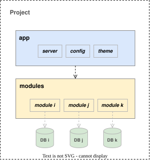
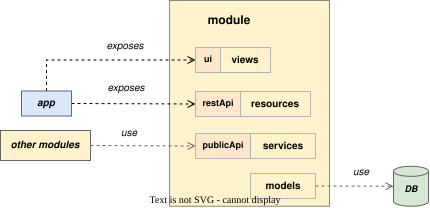
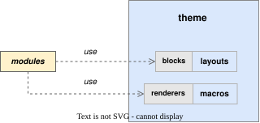

# Pigal-Flask

Pigal-Flask is an Flask extension which facilitates the creation and management of Pigal projects. 
A **Pigal project** is a modular web portal for an organisation which need to build progressively 
an integrated information system. **Pigal** means in french ("Portail d'information et de gestion des activites en ligne").




A **project** follow a modular architecture based on 02 components as shown above:
- **app** which provide global theme, configuration and flask extensions
- **modules** which provide home pages, authentification and authorisation services and other business functionalites




A **module** is composed of :

- **views** which provides a User Interfaces (*UI*) to browser
- **resources** which provides a Rest API (*RestApi*) to browser
- **services** which provides a Public Interface (*PublicAPI*) for other modules




A **theme** is composed of:

- **layouts** wihch provides *blocks* to extend by module jinja templates
- **macros** which contains *renderer* functions to render html components of pages


## Installation

Use the following command to install `Pigal-Flask` extension:

```bash
pip install Pigal-Flask
```

## Quickstart

### Create new project

To create a new project ``MyProject``, use the following command :

```bash
pigal create-project MyProject
```

This will create a pigal project with the following structure:

```
/MyProject                # CREATED PROJECT DIRECTORY
|   
|-- /app                  # APP DIRECTORY
|   |-- /theme            # global theme directory
|   |-- config.py         # app configurations
|   |-- extensions.py     # app flask extensions
|   |-- server.py         # app flask server
|   
|-- /modules              # MODULES DIRECTORY
|   |
|   |-- /auth             # authentification and authorization module
|   |   |-- /static       # auth static files
|   |   |-- /templates    # auth page templates
|   |   |-- config.py     # auth configuration
|   |   |-- models.py     # auth db models
|   |   |-- resources.py  # auth resources and Rest API
|   |   |-- services.py   # auth services and Public API
|   |   |-- views.py      # auth view routes and User Interface
|   |
|   |-- /home             # home and default module
|   |   |-- /static       # home static files
|   |   |-- /templates    # home page templates
|   |   |-- config.py     # home configuration
|   |   |-- models.py     # home db models
|   |   |-- resources.py  # home resources and Rest API
|   |   |-- services.py   # home services and Public API
|   |   |-- views.py      # home view routes and User Interface
|   
|-- /migrations           # databases migration files
|-- /tests                # project tests  


```

To see and customize the project, navigate to `MyProject` directory and run the flask app:

```bash
cd MyProject
flask run --debug
```

Go to http://127.0.0.1:5000 to see the default project page.
Go to http://127.0.0.1:5000/api to see the default project Rest API.


### Customize project theme

You can change the theme of a project, by importing another theme. To import a theme, navigate to project directory and use `import-theme` command with the path of the theme file:

```bash
cd MyProject
pigal import-theme ./new_theme.zip
```

Go again to http://127.0.0.1:5000 to see the new theme. 


### Create new module

To create a new module `MyModule`, navigate to project directory and use `create-module` command:

```bash
cd MyProject
pigal create-module MyModule
```

This will create the following structure:

```
/modules
|   
|-- /my_module            # CREATED MODULE DIRECTORY
|   |-- /static           # static files
|   |-- /templates        # page templates
|   |-- config.py         # configuration
|   |-- models.py         # db models
|   |-- resources.py      # resources and Rest API
|   |-- services.py       # services and Public API
|   |-- views.py          # view routes and User Interface

```


Go to http://127.0.0.1:5000/my-module to see default `MyModule` page. 
Go to http://127.0.0.1:5000/api/v0/my-module to see default `MyModule` Rest API. 

> [!IMPORTANT]
> Pigal-Flask automatically rename module directory and urls to respect standard conventions concerning **URL naming conventions** and **python naming convention**

you can now create databases, change frontends and backends (see [Documentation](#)).


## Contributions


## Licences

